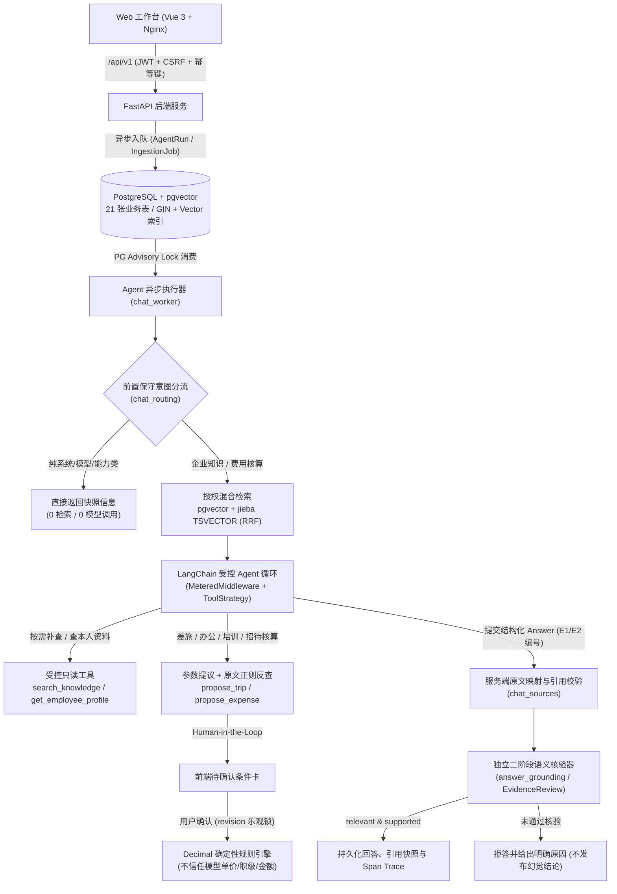
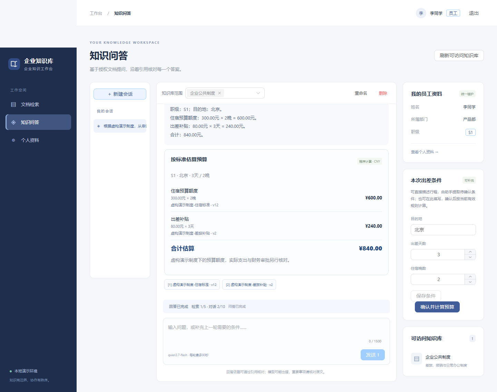
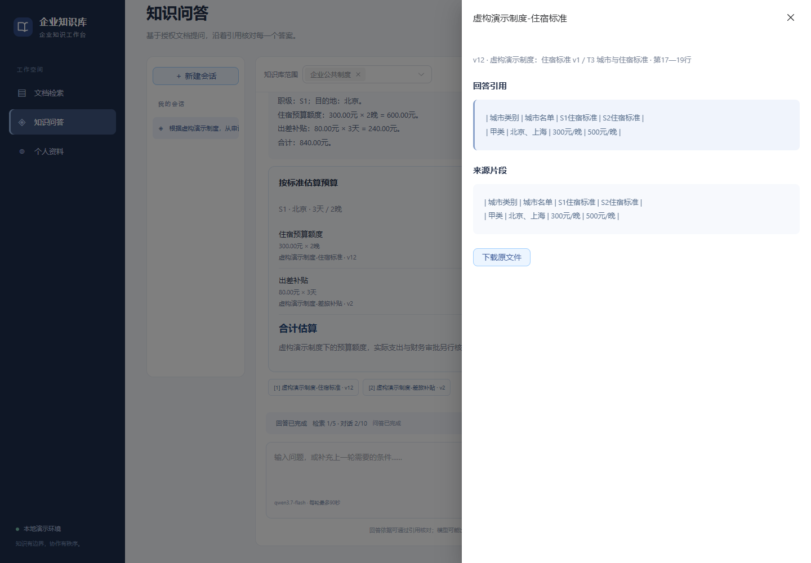

# 企业知识问答与费用核算 Agent 系统

面向企业内部制度查询与费用参考核算的全栈 AI Agent 系统，围绕**可运行、可评测、可观测、权限可控**的工程目标构建，解决传统 RAG 场景中常见的**无关条款误召回、引用伪造、越权信息泄露与大模型直接算账产生数值幻觉**等核心问题。

> **技术栈**：Python 3.13 · FastAPI · LangChain (`create_agent` + `Middleware` + `ToolStrategy`) · PostgreSQL + `pgvector` · SQLAlchemy (Async) + Alembic · Vue 3 + TypeScript + Element Plus · Docker Compose + Nginx · Pytest (204 项) + Playwright E2E

---

## 核心架构与 Agent 执行链路



---

## 核心工程亮点

1. **受控 Agent 编排与完整状态机**
   - 基于 LangChain `create_agent` + 自定义 `MeteredMiddleware` + `ToolStrategy(Answer)` 构建结构化执行循环。
   - 任务全生命周期持久化（`queued / running / completed / needs_clarification / insufficient_evidence / partial / cancelled / timeout / failed`），支持 `client_request_id` 请求幂等、`context_revision / profile_revision` 乐观锁、超时截止与运行中取消。
   - 显式应用层重试与调用限额保护（默认每轮 5 次检索、10 次模型请求、180s 超时），触达上限时安全降级返回 `partial` 候选原文而非裸报错或编造答案。

2. **权限隔离混合检索（RAG）与历史一致性**
   - 支持 `.md`、文字 `.pdf`、`.docx` 解析与结构化位置锚点（标题路径、行号、页码、表格行）。
   - PostgreSQL `pgvector`（1024 维 `text-embedding-v4`）与 `jieba` 分词 `TSVECTOR` (GIN 索引) 双路召回，使用 RRF（Reciprocal Rank Fusion）融合排序。
   - 检索、工具调用、模型请求及发布前均实时复核用户状态、Token 族、知识库授权与文档版本；管理员撤权或删除源文档后，历史回答与引用自动降级隐藏（`source_unavailable`）并移出后续对话上下文。

3. **人机确认 + 确定性计算分离 & 二阶段幻觉治理**
   - **高可信工具调用**：覆盖差旅住宿/补贴及办公采购、培训报销、业务招待四类费用；服务端使用 `explicit_quantities` 正则反查用户输入，阻断模型擅自补数（如从“3 天”猜“2 晚”），用户确认条件卡后由 `Decimal` 规则引擎结合数据库有效规则精确计算。
   - **防引用伪造与相关性核验**：模型仅选择本轮证据短编号（`E1/E2`），由服务端映射真实片段并回填原文；文档类回答发布前须经独立的二阶段核验器 `EvidenceReview` 校验相关性与结论支持度。

4. **全链路可观测性与成本熔断**
   - **结构化日志与 Span 追踪**：自动注入 `trace_id / run_id` 并脱敏过滤敏感字段（密钥、用户提问、文档全文、工具入参），将 `routing / retrieval / llm / tool / evidence_review / finish` 各阶段耗时与工具校验结果持久化至 `run_events`，提供 `GET /api/v1/runs/{run_id}/trace` 聚合查询。
   - **预算账本与熔断保护**：基于数据库事务锁实现调用前估算预留（`reserve`）、返回后按实际 Token 结算（`settle`）、异常保留保守预留，支持 80/100 元告警与自动暂停。

---

## 四维评测与回归验证结果

完整评测数据、工具调用合规细节与失败案例迭代记录见 [docs/评测报告-四维指标汇总.md](docs/评测报告-四维指标汇总.md)。

| 评测集 | 模型 / 环境 | 任务完成率 | 工具调用准确性 | 时延 P50 / P95 | 总估算成本 (CNY) |
| --- | --- | --- | --- | --- | --- |
| M6 固定知识问答（20 题） | `qwen3.7-flash` + `text-embedding-v4` | **20/20 (100.0%)** | **20/20 (100.0%)** | 4.381s / 9.341s | ¥0.028186（均值 ¥0.001409/题） |
| 综合费用与多条款引用（5 题） | `qwen3.7-flash` | **5/5 (100.0%)** | **5/5 (100.0%)** | 5.480s / 9.036s | ¥0.014413（均值 ¥0.002883/题） |
| 证据核验器对抗拦截（2 题） | 独立二阶段核验器 | **2/2 (100.0%)** | 100.0%（`EvidenceReview`） | — | 已纳入隔离账本 |
| 模型选型对照（10 题） | `qwen3.7-flash` vs `qwen3.7-plus` | 均 **10/10 (100%)** | — | 3.071s vs 4.280s (P50) | **Flash 降本 87.0%**（¥0.0074 vs ¥0.0570） |
| 后端全量自动化回归 | 隔离 PG + 真实 LangChain 图 + 假模型 | **204/204 (100.0%)** | 覆盖参数反查/越权/幂等/重试/Trace | 零外网费用 | ¥0.00 |

---

## 界面展示

### 1. 条件确认卡与程序确定性预算核算


### 2. 原文位置锚点与引用核对抽屉


---

## 快速开始（Docker Compose 一键部署）

### 1. 准备环境变量

```bash
# 首次运行生成随机数据库密码与 JWT 密钥（写入本地 .env）
python scripts/bootstrap_m0.py
```

在 `.env` 中填入阿里云百炼兼容模式 API Key（也可不填直接体验系统分流、文档管理、权限与规则计算；联网检索与对话需配置有效 Key）：

```env
DASHSCOPE_API_KEY=your-api-key
DASHSCOPE_BASE_URL=https://dashscope.aliyuncs.com/compatible-mode/v1
CHAT_MODEL=qwen3.7-flash
EMBEDDING_MODEL=text-embedding-v4
EMBEDDING_DIMENSIONS=1024
```

### 2. 一键构建并启动全栈服务

```bash
docker compose --env-file .env -f infra/compose.yaml up -d --build --wait
```

启动完成后会自动依次拉起：
- `db`：PostgreSQL + `pgvector`（健康检查通过后放行）
- `init`：自动执行 `prepare-db` → `alembic upgrade head`（`0007_observability`）→ 初始化演示账号与知识库
- `backend`：FastAPI + 文档解析/Agent 后台 Worker（`http://127.0.0.1:8000`）
- `frontend`：Vue 3 生产构建 + Nginx 反向代理（`http://127.0.0.1:5173`）

### 3. 访问入口

- **Web 工作台**：`http://127.0.0.1:5173`
- **API 交互文档 (Swagger)**：`http://127.0.0.1:8000/docs`
- **健康检查**：`http://127.0.0.1:5173/health`
- **初始演示账号**：`admin`、`employee_li`（公共制度，S1）、`employee_wang`（公共+研发资料，S2），随机密码位于本机 `data/runtime/demo-credentials.json`（已忽略提交）。

停止容器（保留数据库数据卷）：

```bash
docker compose --env-file .env -f infra/compose.yaml down
```

---

## 本地开发、测试与评测复现

如仅启动数据库容器进行本地开发与测试：

```bash
docker compose --env-file .env -f infra/compose.yaml up -d --wait db
```

### 代码检查与零费用自动化回归（204 项）

```bash
# 后端代码规范检查
cd backend
uv run ruff check app migrations tests

# 后端全量测试（使用随机隔离测试库与假模型，真实执行 LangChain 图，不产生 API 费用）
uv run pytest tests -q

# 前端类型检查与生产构建
cd ../frontend
npm ci
npm run build
```

### 生成四维评测报告

```bash
# 基于已有评测归档零费用汇总四维指标报告
python scripts/eval_report.py

# 显式触发隔离库真实模型评测（会产生少量百炼费用，自动预留并结算预算账本）
python scripts/m6_evaluate.py --live --suite m6
python scripts/m6_evaluate.py --live --suite expenses
```

---

## 目录结构

```text
.
├── backend/
│   ├── Dockerfile                 # Python 3.13 + uv 生产镜像
│   ├── app/
│   │   ├── api/                   # REST 接口（认证/文档/会话/Trace/费用/审计）
│   │   ├── core/                  # 配置、数据库、安全、结构化日志/Telemetry、四维评测引擎
│   │   ├── services/              # Agent 编排、路由、混合检索、解析、证据核验、确定性费用计算
│   │   └── models.py              # 21 张业务表 SQLAlchemy ORM 模型
│   ├── migrations/versions/       # Alembic 迁移（0001_m1 ~ 0007_observability）
│   └── tests/                     # 204 项后端自动化测试与显式真实评测套件
├── frontend/
│   ├── Dockerfile                 # Node 24 构建 + Nginx 1.27 多阶段镜像
│   ├── nginx.conf                 # /api 反向代理与 SPA 路由配置
│   ├── src/                       # Vue 3 + Pinia + Element Plus 工作台与管理后台
│   └── e2e/                       # Playwright 端到端浏览器自动化测试
├── infra/
│   └── compose.yaml               # db + init + backend + frontend 全栈编排
├── scripts/                       # 初始化、零费用评测报告汇总、真实模型评测与对照脚本
├── data/                          # 虚构演示制度文档与固定评测用例集
└── docs/                          # 架构设计、迭代修复记录与四维评测报告
```

---

## 核心文档导航

- **四维评测报告**：[docs/评测报告-四维指标汇总.md](docs/评测报告-四维指标汇总.md)
- **系统架构与 Agent 设计**：[docs/总体架构与业务流程-v0.1-讨论稿.md](docs/总体架构与业务流程-v0.1-讨论稿.md) · [docs/Agent与RAG工作流设计-v0.1.md](docs/Agent与RAG工作流设计-v0.1.md)
- **数据库与接口设计**：[docs/数据库表结构设计-v0.1.md](docs/数据库表结构设计-v0.1.md) · [docs/API接口设计-v0.1.md](docs/API接口设计-v0.1.md)
- **关键故障排查与迭代记录**：
  - [docs/问题分流与证据相关性修复记录.md](docs/问题分流与证据相关性修复记录.md)（误召回分流、独立核验器与并行补查竞态修复）
  - [docs/综合费用与问答稳定性修复记录-2026-11-19.md](docs/综合费用与问答稳定性修复记录-2026-11-19.md)（四类综合费用核算与短编号引用机制）
  - [docs/M3开发与验收记录.md](docs/M3开发与验收记录.md) · [docs/M6开发与验收记录.md](docs/M6开发与验收记录.md)
