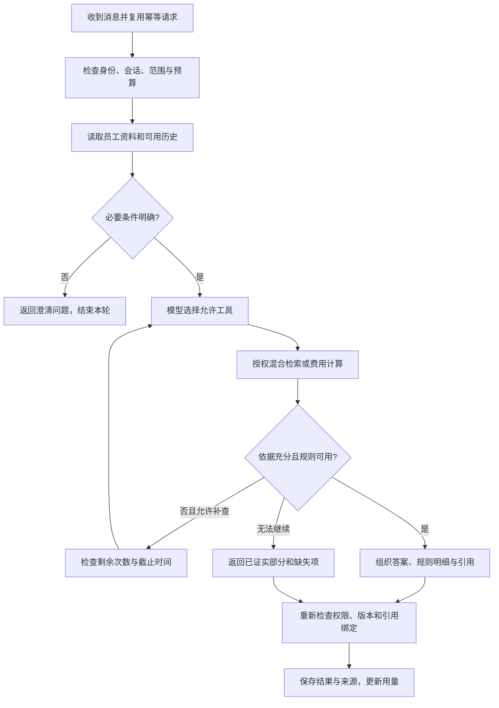

# Agent与RAG工作流设计 v0.1：草案

实施更新（2026-11-19）：按用户授权加入保守问题分流，明确的系统信息及帮助由可信配置/程序直接回答，混合问题保留企业知识部分。文档类候选答案在原文与权限校验后，增加一次独立、计费的证据相关性/支持性核验；共享原有调用和预算限制，拒绝或失败不发布候选结论。该核验不是新的业务验收签字，也没有新增未经校准的向量阈值，详见[修复记录](问题分流与证据相关性修复记录.md)。

M6实施更新（2026-11-04）：数量提议须匹配当前用户明确输入或已确认卡，缺晚数不得猜测；结构化错误修正共享10次/90秒限额；最近命中刷新证据顺序，合并预算/指南时补查并附核验原文，共享5次检索及授权约束。金额仍由程序生成，见[M6记录](M6开发与验收记录.md)。

日期：2026-11-03（Asia/Shanghai）

## 已确认与待设计

M5更新（2026-11-04）：文档当前版本发布、关联规则暂停和操作记录在同一事务落地；管理员复核当前条款与单价后逐条恢复。到期/KB停用等状态仍在每次计算/历史读取时检查，并由后台补记暂停原因。管理历史不含员工聊天或模型思考，Agent没有管理写工具；5/10/90与80/100保护继续有效。实际闭环与边界见[M5记录](M5开发与验收记录.md)。

M4更新（2026-11-04）：新增`propose_trip_context`生成待确认卡，及不接受单价/身份参数的`calculate_travel_budget`。普通聊天提取值不写入确认条件；用户点击确认后，保存条件并绑定context/profile revision，再允许Agent调用程序计算。费用结果和正文由服务端取得当前有效规则并计算，不由模型覆盖。条件卡直接计算复用同一服务且不调用模型。实际流程见[M4记录](M4开发与验收记录.md)，本段及阶段记录优先于下文早期工具草案。

M3实施更新（2026-11-04）：私有会话、初次检索、真实LangChain create_agent、受控补查/本人资料工具、结构化回答与引用校验、澄清、调用限额、进度/取消/刷新恢复已实现。任一计数达到5次检索或10次对话上限，均停止两类新增付费调用；90秒包含排队和初次检索。工具前、模型前、发布及历史读取复核当前权限与来源。实际流程和参数以[M3记录](M3开发与验收记录.md)为准；费用计算工具与规则恢复闭环留在M4/M5，下文相关段落仍为设计。

M2文档索引与混合检索继续使用text-embedding-v4/1024维、每批10条、800字符/120重叠、两路20条/RRF/最终6条工程默认值，详见《M2开发与验收记录.md》。M3默认qwen3.7-flash，使用相同10例与Plus真实对照后选择；不把阶段检查当成最终40例验收。

已确认：混合检索、百炼对话/向量API、LangChain Agent、权威员工资料、标准预算计算、来源追溯、每轮5次知识检索/10次对话请求/90秒及严格历史访问。

以下分段、参数、工具契约、状态和重试为建议。第七轮已确认运行/JWT/账号/输入/预算/页面方向；M0a只验证本地依赖和离线Agent构造，真实模型/向量和完整RAG工作流未运行。

## 文档索引流程建议

1. 管理员上传并校验实际格式、大小、有效期；创建版本和持久任务记录。
2. Markdown保留标题路径/段落；PDF保留真实页码；DOCX保留标题、段落顺序和表格位置。
3. 正文按标题和段落切分；简单表格保留列标题与行关系，必要时将标题和行内容一起写入片段，不能只留下无归属数字。
4. 初始候选为每片段约800中文字、重叠约120字；不跨无关条款拼接。表格和段落结构优先于固定长度，最终以测试调整。
5. 生成中文分词字段和向量，保留原始片段、位置、模型、维度和配置版本；同一检索空间内保持一致。
6. 全部完成后发布当前版本；失败或无法可靠提取的关键内容明确反馈，不伪装全部处理成功。
7. 替换发布事务同时暂停依赖旧版本的费用规则；管理员对照新条款核对并恢复。

分段长度不是模型Token限制。实际请求按选定模型的长度和批量要求校验；更换向量模型/维度须按新配置重建索引，不混查不同空间。

## 混合检索建议

服务端先建立用户身份、当前授权KB、文档当前版本和有效期条件，两分支使用同一可访问集合。

- 关键词分支：中文分词加业务词表，候选使用PostgreSQL全文检索和原生排名。分词器、同义词和字段权重需验证。
- 向量分支：问题向量与pgvector相似查询；小规模先测精确检索，扩大后再评估近似索引。
- 初始候选：两分支各取最多20条，用RRF合并，按片段ID去重，最终最多6条进入上下文；参数均为待评测建议。
- RRF候选公式为两路排名的1/(60+rank)之和。不能把向量相似度直接当作答案正确概率。
- 两路检索、融合结果、最终上下文及引用都要保持授权和版本约束。模型输入前与最终返回前重新检查来源状态。

纯向量仅作为对照评测，首版交付必须包含混合检索。检索无结果或覆盖不足时可补查，不能用模型记忆补造企业制度。

## 工具契约建议

| 工具 | 输入 | 可信输出与约束 |
| --- | --- | --- |
| 当前员工资料 | 不接受任意员工ID；读取服务端绑定身份 | 本人部门、职级、资料revision；不能靠对话切换身份 |
| 授权知识检索 | query；KB范围只能由服务端确认 | 片段、来源ID/版本、真实文字、位置；单次完整混合检索计1次，子查询分别计数 |
| 差旅预算估算 | destination、travel_days、lodging_nights | 服务端读取职级和有效规则，返回标准、数量、金额、依据和缺失项；模型不传权威单价/职级 |

每次执行前校验身份、参数与调用预算。字段缺失或不合法时返回可澄清的结构化原因，金额不采用自由文本运算结果。

## 对话执行流程建议

新一轮只使用仍可访问的历史，不将旧版本金额直接当作当前规则。用户改条件、管理员改资料或制度变化时重新取得输入与依据；必要时提示重新确认。

## 计数、停止与重试

已确认边界：每轮5次知识检索（首次及补查合计）、10次对话模型请求、90秒。任一先达到即停止新增调用。重试分别占用对应次数，不能把一个工具中的多个子查询合并记作一次。

建议：瞬时网络/限流错误在余量允许时最多重试1次，参数错误、授权失败、规则失效不盲目重试；文本向量调用独立记账并计入总体时间。调用前原子保留计数，并发工具调用不能突破限额。

当截止时间到达或用户取消时，停止新增请求并尽可能取消等待；已发往服务商的请求可能已经产生费用，应如实记录未知/在途状态。90秒是停止条件，不能保证外部网络返回恰好在此时完成。

## 计算与依据

基线是住宿标准×晚数＋80元/天×出差天数；标准来自管理员核对的当前规则。职级与城市矩阵、1—30整数天和0≤晚数<天数已确认。未列明城市、规则暂停/冲突时不产生完整合计。

计算项返回规则ID/版本、来源条款、单价、数量和金额。管理员启用前核对条款与参数，程序负责版本、字段、单位、条件和冲突检查，不声称自动证明任意文档与手工参数语义一致。

## 引用、历史与输出

- 模型只使用本次允许的来源标识，服务端核对引用存在、归属、权限与位置；重要事实仍需人工验收其支持性。
- 输出建议包含答案/步骤、员工属性、本次条件、预算明细、引用、未解决项。
- 撤权或源文档删除后，受影响历史回答及引用不再通过接口返回，也不进入后续模型上下文。
- 原文中的指令只作为资料内容，不得改变工具范围、权限、次数或预算。
- 页面显示检索/补查/计算等操作状态与证据，不展示模型内部思考。

## 验证

分开核对检索召回、回答关键点与引用支持性、费用复算、权限和停止条件。40例验收按已确认分布执行；实际运行、成本和响应时间均尚未测量。模型与配置变更后记录新版本，并只对受影响环节及必要验收集回归。
