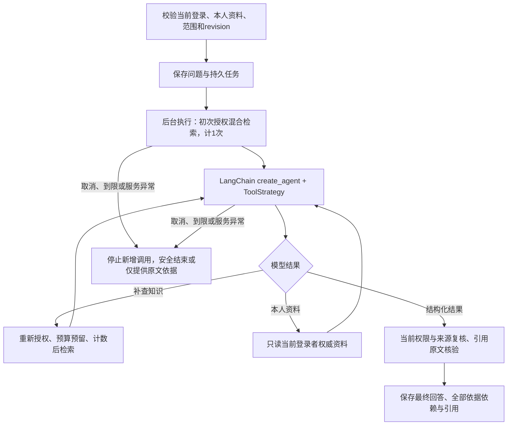

# M3 问答与 Agent 开发及验收记录

日期：2026-11-04（Asia/Shanghai）

## 交付状态与决策来源

用户已明确授权执行M3，并选择“沿用百炼Qwen，按原计划对照Flash/Plus后选默认”。该选择及原有个人会话、权限、RAG、LangChain Agent、5/10/90限制属于已确认需求。以下实现参数和默认型号是按授权落地的工程结果，不声称用户逐项单独认可了所有实现细节。

M3已完成个人多轮问答、受控工具补查、澄清、可核对引用、任务控制与配套界面；真实百炼调用通过。M1/M2功能回归通过。M4费用规则与程序计算尚未实现，M5规则更新闭环和M6固定40例业务验收仍待后续阶段。

## 可使用的功能

- `/`新建问答，`/chat/{id}`打开个人会话；自动标题、重命名、删除、历史分页、追问和刷新恢复。
- 默认选中当前可访问知识库，可保存会话范围；范围和出差条件修改使用revision，运行中不能修改。
- 展示管理员维护的本人姓名、部门、职级；条件卡仅允许目的地、1—30整数天、非负且少于天数的整数晚数。发送时可一并保存条件，不能提交职级、角色或他人ID。
- 先混合检索，再调用模型；可调用只读补查和本人资料工具。没有依据或必要条件缺失时返回明确结果。
- 回答下的引用由服务端编号；抽屉展示原文摘录、片段全文、版本与位置，并通过鉴权请求下载原文件。
- 可见操作进度和计数，支持取消；刷新恢复当前运行或最近结束状态。重启中断显示`INTERRUPTED`，不自动重新发起付费问答。
- 提交使用`client_request_id`幂等，同一请求重复提交返回原任务；同一标识不同内容、旧revision和同会话已有运行返回409。

## 实际 Agent / RAG 执行链



真实使用`langchain.agents.create_agent`、异步middleware、`search_knowledge(query)`、`get_employee_profile()`与`ToolStrategy(Answer)`。工具不接受任意员工ID、KB ID、单价或可写操作。进度仅保存固定操作标签，不发布模型内部思考、原始工具输入或文档片段。

每轮最多5次知识检索、10次对话模型请求、90秒；**任一调用计数达到上限后，两类新增付费调用均停止**。初次检索计1次，单次关键词/向量两路融合计一次检索，瞬时失败重试另计一次。对话SDK关闭自动重试，应用对连接/限流/服务端瞬时错误最多再尝试一次，分别计数及记账。检索502/503最多重试一次。90秒从任务创建开始，包含排队、初次向量检索、模型和重试；取消/超时中断在途客户端请求，不能保证服务商停止已收到请求的计费。

工程默认值：单轮一个后台任务，本机单个聊天worker以数据库锁防重复；另有文档worker。历史最多读取12条消息，再按约4500个UTF-8字节裁剪；证据集最多10片段、每段发送前500字符；单次模型输入估算上界含余量不超过30000字节，输出默认1800 Token；另有每轮20次一般工具防循环保护。上述属于实现默认值，可在后续评测中有依据地调整，不能放宽已确认5/10/90边界。

## 权限、历史与引用

所有会话、消息、运行、进度和引用都检查所有权；管理员也不能查看员工私聊。检索、工具、模型调用前和最终发布前复核当前用户、令牌族、员工资料revision、条件revision、知识库授权和文档状态。已变化则结束本轮，不能继续沿用旧权限快照。

为保守处理跨文档依据，记录**本轮全部检索片段**作为回答依赖，另用`is_cited/citation_index`标记展示引用。读取历史和引用时重新检查当前范围、授权、当前版本、有效期及向量空间；任一依赖不可用则隐藏整条助手回答和全部引用，返回`source_unavailable`，不向浏览器返回旧正文。新模型上下文排除受影响的问答对；员工资料revision变化时也排除旧资料下的问答对。前端重新加载/获得焦点时重查历史；已呈现在屏幕上的文字无法从用户记忆或截图撤回，未实现实时撤回推送。

模型提交的引用必须是本轮实际检索的chunk ID，摘录必须是原文连续子串，不得重复同片段。伪造引用拒绝发布。正文里模型自行生成的数字引用标记、已检索片段内部ID被移除，展示编号由服务端控制。该机制校验来源归属和原文一致性，不能自动证明每一句自然语言都被条款语义支持，仍需业务评测。

会话/文档为逻辑删除；物理保留和备份策略仍待细化，不把访问阻断描述为物理擦除。

## 模型对照与默认选择

固定题目：`data/evaluation/m3-model-cases.json`。同一三份M2技术样例、相同权限/参数下，两个候选各运行10例，覆盖城市和职级标准、每日补贴、材料、跨文档依据、未知城市、本人资料和目的地澄清。先做基础自动检查，再逐条人工核对答案及引用内容；早期对照暴露的过度拒答和引用编号问题已修正。

| 候选 | 最终基础检查 | 10例估算费用，含问题向量 | 单例耗时中位数 |
| --- | --- | --- | --- |
| qwen3.7-flash | 10/10 | 0.00740370元 | 3.071秒 |
| qwen3.7-plus | 10/10 | 0.05697300元 | 4.280秒 |

按已授权比较过程，默认选用**qwen3.7-flash**：此固定小样本达到相同基础检查结果，费用和中位耗时更低。向量继续使用`text-embedding-v4`、1024维，模型调用关闭思考模式；未切换DeepSeek。

价格估算按2026-11-04核对的北京短输入原价：Flash输入/输出0.2/0.8元每百万Token，Plus为2/8元，向量0.5元每百万输入Token。不假定免费额度，不扣缓存优惠或限时折扣；实际账单以[百炼官方价格及账号账单](https://help.aliyun.com/zh/model-studio/model-pricing)为准。更换地域/型号/价格需要先核对适配与记账配置，不能只替换字符串就宣称兼容。

所有对话、向量及失败/未知预留共用数据库预算锁：80元提醒，预留后预计超过100元则暂停新增请求。收到usage后按输入/输出Token结算应用估算；失败或取消费用不明时保留预留，不伪造零费用。进程中断可能保留`reserved`记录，仍计入预算。精确汇总见`.m3/final-summary.json`；本阶段含早期调试、两轮比较和浏览器验证，不能把上表最终一轮比较当作阶段全部费用。

本次验收快照：关联M3问答任务的用量估算为**0.13404930元**，应用全部模型调用累计估算**0.13437330元**；含早期一次中断向量调用保留的0.000033元未知预留，未当作零费用释放。两项均为应用侧估算，不是百炼实际扣款。

## API 实际契约

统一前缀`/api/v1`，Bearer鉴权；成功外层为`data/request_id`。实际Schema以本机`/openapi.json`为准。

| 方法 | 路径 | 行为与主要字段 |
| --- | --- | --- |
| GET | /chat/config | 服务可用性、默认模型、5/10/90限制；不返回密钥 |
| GET / POST | /conversations | 本人列表（offset，每页30）/创建（title、knowledge_base_ids可选） |
| GET / PATCH / DELETE | /conversations/{id} | 本人会话、改标题/范围（expected_revision）、逻辑删除204 |
| PATCH | /conversations/{id}/trip-context | trip_context、expected_revision；条件全量替换，空对象清除 |
| GET | /conversations/{id}/messages | 最新50条，before时间游标向前分页；返回已重新授权的消息 |
| POST | /conversations/{id}/messages | 202；content为1—1500字符、client_request_id UUID、context_revision，可选trip_context；不允许客户端选择模型/修改职级 |
| GET | /runs/{id} | 状态、计数、deadline、stop_reason、响应消息ID |
| GET | /runs/{id}/events | after_seq增量读取，单次最多100条固定进度标签 |
| POST | /runs/{id}/cancel | 202；已结束的任务不再次运行 |
| GET | /citations/{id} | 当前可访问原文、摘录、位置和下载地址 |

会话响应含`active_run_id/latest_run`以恢复当前及最近结束状态。运行状态包括queued/running、completed、needs_clarification、insufficient_evidence、partial、cancelled、timeout、failed。停止原因与用户友好提示分开；详细标识如SEARCH_LIMIT、MODEL_LIMIT、DEADLINE、AUTH_CHANGED、SCOPE_CHANGED、SOURCE_UNAVAILABLE、CONTEXT_VERSION_CONFLICT、BUDGET_PAUSED、INTERRUPTED。

## 数据与代码

迁移`0003_m3`新增conversations、conversation_scopes、messages、message_sources、agent_runs、run_events六表，业务表累计17张。usage_records新增输出Token、run外键和价格快照。同会话唯一活动运行以部分唯一索引保证，幂等以(actor_id, client_request_id)唯一和请求哈希保证；ORM/迁移一致性已检验。

- `backend/app/chat_protocol.py`：会话、条件、消息和结构化答案校验。
- `backend/app/services/conversations.py`：私有会话、幂等、范围、历史及引用授权。
- `backend/app/services/chat_agent.py`：Agent、工具、middleware、计数、进度和worker。
- `backend/app/services/chat_models.py`：百炼适配、预算预留和usage结算。
- `backend/app/api/conversations.py`：HTTP接口。
- `frontend/src/views/ChatView.vue`：问答、会话历史、条件与引用交互。
- `scripts/m3_model_compare.py`：显式联网对照；`scripts/m3_verify.py`：不联网模型的只读验收汇总。

## 验证证据与复现

最终后端**52项全部通过**，使用独立测试数据库/本地假模型，实际执行LangChain图；覆盖M1/M2回归、私聊越权、幂等、revision、撤权/替换隐藏及上下文排除、模型中途撤权、无依据与伪造引用、5/10/90、跨类型到限停止、重试、取消、费用保留、预算阻断和引用编号清理。Ruff检查、格式检查、Vue类型检查和生产构建通过。

最终浏览器**8条全部通过**（M1四条、M2两条、M3两条），连接本机真实服务：登录/角色/刷新/移动布局、文档上传替换和权限、真实多轮回答与引用下载、条件保存与刷新、管理员读取员工会话404、撤权隐藏、取消与删除。测试结束恢复成员授权并逻辑删除临时文档/会话，保留三份技术样例。桌面和移动截图已核对。

本机证据目录`.m3/`已忽略提交：`backend-results.xml`、`browser-results.json`、`model-comparison.json`、`model-selection.json`、`chat-desktop.png`、`chat-mobile.png`、`openapi.json`、`final-summary.json`。初轮模型报告另留`model-comparison-initial.json`用于追溯；最终比较之后仅修正显示清理和限额边界，固定比较中最高2次检索/2次模型请求，不受限额修正影响，未重复产生整组比较费用。

运行命令见README。复核当前服务且不调用模型：

```powershell
backend/.venv/Scripts/python.exe scripts/m3_verify.py
```

数据库须先迁移到`0003_m3`，已有M1/M2数据保留。更改后端或`.env`后先`./scripts/stop.ps1`再`./scripts/start.ps1`。构建仍有入口包超过500KB的提示，当前本机演示可用；拆包优化留给确有加载问题时，不阻碍本阶段交付。

## 待后续处理

- M4：费用来源规则、当前有效性校验、住宿与补贴的十进制程序计算、费用明细及算例。
- M5：新制度替换后的规则暂停/管理员核对恢复、完整管理一致性与规则历史。
- M6：冻结正式模拟资料和标准答案，执行固定40例完整业务验收与展示准备。当前技术样例和模型10例对照不能替代该验收。
- 单机串行聊天worker适合当前演示；多进程/多机任务队列、实时撤回推送、物理保留期限和生产部署尚未作为本阶段成果。
