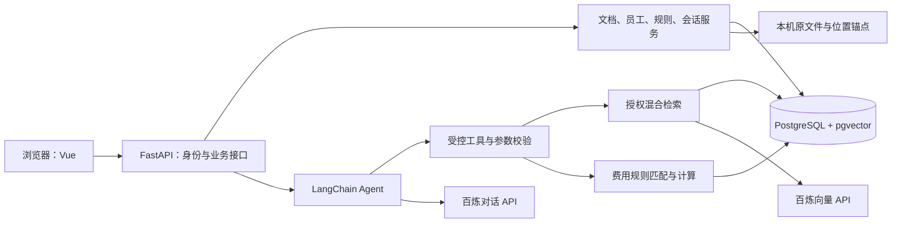

# 总体架构与业务流程 v0.1：讨论稿

M6实施更新（2026-11-04）：既有FastAPI/Vue/PostgreSQL+pgvector/百炼/LangChain架构不变。四份虚构制度已冻结，固定40例开发验收完成；真实评测隔离业务数据库并回收用量，尚未扩展为生产部署，见[M6记录](M6开发与验收记录.md)。

日期：2026-11-03（Asia/Shanghai）

## 状态

M5更新（2026-11-04）：新增管理操作历史服务及21号业务表、数据库历史保护触发器、来源核对恢复接口和管理页面、用量明细页。既有单个文档worker承担周期来源有效性检查，计算/读取即时校验继续独立生效；管理变更与历史在同一事务提交。不是分布式审计平台或外部不可篡改存证。具体结构与验证见[M5记录](M5开发与验收记录.md)。

M4更新（2026-11-04）：费用规则和Decimal程序计算服务已落地，Agent可提议待确认行程并在显式确认后调用预算工具；条件卡直接计算复用该服务。规则来自管理员核对的原文和参数，不从模型自由生成数值取得。新增三张费用表、规则管理界面、预算及分项来源。来源发布替换/删除事务会暂停关联规则，读取预算复核当前来源与规则revision。M5完整管理闭环仍待后续；详见[M4记录](M4开发与验收记录.md)。

已确认技术方向：FastAPI + Vue、PostgreSQL + pgvector、百炼对话及文本向量 API、混合检索、LangChain Agent、位置引用及授权下载。

M3更新（2026-11-04）：M1身份/权限、M2文档索引/混合检索、M3私有会话/问答/受控Agent已实现，真实百炼对话及向量通过。当前FastAPI生命周期内启动文档worker与单个聊天worker，通过PostgreSQL持久任务和数据库锁协调；浏览器以HTTP轮询进度，不使用SSE。LangChain工具为授权知识补查与本人资料，实际参数见[M3记录](M3开发与验收记录.md)。下文费用计算/规则组件及分布式扩展仍为设计，M4/M5再落地。

## 组件草案

前端通过业务接口访问资料；服务端绑定登录身份并计算授权范围。Agent、检索、原文件和历史访问均使用服务端权限，用户提问不能授予权限。

## 各部分职责建议

| 部分 | 职责 |
| --- | --- |
| Vue | 管理员与员工界面、会话、条件澄清、状态反馈、计算明细与引用 |
| FastAPI 业务层 | 身份、知识库授权、文档生命周期、员工资料、规则、会话、引用和下载 |
| LangChain Agent | 在允许工具与限制内组织检索、补查和计算，形成回答 |
| PostgreSQL | 用户、授权、员工资料、文档/版本、规则、会话、任务、调用记录及关键词检索数据 |
| pgvector | 文档片段向量与授权范围内的向量相似检索 |
| 本机文件存储 | 原文件及解析产物，通过鉴权接口提供下载 |
| 百炼 | 对话生成/工具调用、文档及问题的文本向量化 |

优先围绕现有组件形成可运行单机方案；独立队列、其他搜索服务、托管数据库等尚未选入。

## 文档处理与发布流程建议

上传鉴权 → 保存待处理文件与任务 → 按页/段落解析并保留来源位置 → 分段 → 中文分词与关键词字段 → 百炼向量化 → 将片段、关键词数据、向量和版本元数据写入 PostgreSQL → 成功后使有效版本可检索。

处理失败记录原因并允许重试，不把不完整索引发布为可用内容。建议保留可查询任务状态；进程重启后的中断任务应有明确的可重试状态，具体执行方式待定。

已确认新文档生效后暂停受影响旧费用规则，管理员核对新条款后恢复。建议替换准备完成后在数据库事务中切换当前检索版本并暂停相应规则；旧版已失效时不能继续参与当前问答。

已确认删除后停止检索，受影响历史回答及引用不可查看、不得进入后续模型上下文。关联规则与文件清理机制见数据库/API草案；物理保留策略与会话删除细节仍为实现建议。

## 中文混合检索建议

1. 服务端取得当前员工可用知识库及当前有效、处理成功的文档集合。
2. 关键词分支与向量分支使用相同授权和有效性条件。
3. 关键词候选方案：应用侧进行中文分词，配合 PostgreSQL 全文检索字段与原生排序；分词器及专用词规则待验证。
4. 向量分支用百炼问题向量在 pgvector 中查询；首批小数据可用精确检索，近似索引另按规模评估。
5. 建议用 RRF 融合两路排名，再去重并控制上下文；Top-K、RRF 参数与文本长度待测试确认。

PostgreSQL 提供全文检索及排序函数，pgvector 官方说明可与全文检索组合，并以 RRF 或重排序融合。原生全文检索的排序不能直接称为 BM25；中文分词效果需单独验证。

参考：[PostgreSQL 全文检索与排序](https://www.postgresql.org/docs/current/textsearch-controls.html)、[pgvector 官方说明](https://github.com/pgvector/pgvector)。

## Agent 与工具建议

| 工具职责 | 输入与信任边界建议 | 输出建议 |
| --- | --- | --- |
| 读取当前员工资料 | 身份来自服务端会话，模型不能任意指定其他员工 | 允许使用的资料字段与资料版本 |
| 查询授权知识库 | 用户问题/子查询；服务端附加授权和有效性条件 | 片段、来源版本、位置锚点、可引用标识 |
| 估算差旅费用 | 已确认的本次条件；服务端匹配当前可用规则，模型不提供权威单价 | 输入、规则及来源、公式、金额明细、无法计算项 |

推荐执行：建立权限与会话上下文 → 读取可用资料 → 识别问题和缺失条件 → 必要时澄清 → 混合检索/有限补查 → 规则匹配与计算 → 汇总有依据的答案 → 校验引用标识与授权 → 保存消息、来源关联和用量。

规则来源和权限由业务层验证。已确认按标准预算公式与城市/职级矩阵计算；金额使用十进制表示为建议。模型输出只作为待校验输入；缺项、失效或冲突时澄清并阻断受影响计算。

引用绑定校验可确认标识存在、位置和授权；它不能单独证明结论被原文支持。结论支持性和完整性仍需固定测试与人工核对。

百炼官方提供 LangChain 集成和工具调用说明，但适配器、模型、流式事件、超时与用量回传仍需要后续兼容性验证。LangChain Agent 的内部依赖按所选版本管理，未额外确定自定义 LangGraph 状态图。

参考：[百炼 LangChain 集成](https://help.aliyun.com/zh/model-studio/use-bailian-in-langchain)、[百炼工具调用](https://help.aliyun.com/zh/model-studio/qwen-function-calling)、[LangChain Agent](https://docs.langchain.com/oss/python/langchain/agents)。

## 来源、历史与一致性建议

- 每次回答关联来源文档、版本、片段位置和规则版本，便于核对当时依据。
- 新一轮问答重新检查当前授权及有效来源；历史中的旧标准不能直接充当当前规则。
- 历史、引用与下载接口检查当前条件；撤权或删除时不返回受影响回答/引用，不把相关内容放入新模型上下文。版本替换提示与缓存刷新细节继续设计。
- 会话业务数据建议存 PostgreSQL；是否使用 Agent 检查点等机制另行评估，避免把框架记忆等同于完整的权限与历史管理。
- 页面展示可核对的操作状态、资料来源和计算明细；不要求展示模型内部思考过程。

## 费用、调用与运行建议

建议分别记录文档/问题向量请求、对话输入输出用量、补查、重试及相应估算费用。预算目标约 100 元，地区和型号确认后核对价格；提醒、暂停和每轮限制待确认，应用用量统计需要与服务商账单区分。

第六轮已确认每轮最多5次知识检索、10次对话模型请求、90秒；重试计入相应次数，到任一上限停止新增调用。这不是实测响应速度。具体工具重试次数仍为建议。

M0a已验证Python3.13.5、Node24.15.0、Docker29.7.2和本机PostgreSQL17.11/pgvector0.8.7。用户启动Desktop后容器healthy，依赖和镜像已锁定；详见M0记录。M0b真实百炼调用、模型/向量输出及费用尚未测试。

## 待定设计项与下一步

1. 第六轮业务与验收决策已确认；模拟正文和具体测试题目仍作为待冻结素材。
2. 对话/向量型号、地区、维度、依赖版本和百炼适配器。
3. 中文分词、融合参数、检索规模与评测基线。
4. 认证已选JWT＋刷新、数据库已选Docker；令牌默认值、后台任务及进度细节仍按设计实现。
5. 数据库表、API 契约、页面交互、目录规范与实施计划。

当前校核范围为文档一致性、算例算术和官方能力说明；尚未安装项目依赖、调用付费模型或执行业务测试。
