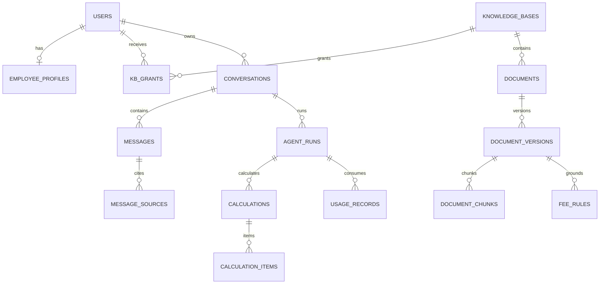

# 数据库表结构设计 v0.1：草案

2026-11-19增量：迁移0006_expenses已落地，仍为21张业务表；增加conversations.expense_context、calculations.expense_snapshot及fee_rules.application_cap/reimbursement_ratio/max_quantity，扩展费用类型与约束。详见[增量记录](综合费用与问答稳定性修复记录-2026-11-19.md)，此前0005_m5说明保留为历史。

M6实施更新（2026-11-04）：仍为0005_m5、21张业务表，无新增迁移。隔离评测使用随机测试数据库；用量记录以m6_操作类型幂等导回主库，保留价格与未知费用预留，外键不指向已删除的测试账号/运行。见[M6记录](M6开发与验收记录.md)。

日期：2026-11-03（Asia/Shanghai）

## 状态与设计边界

M5更新（2026-11-04）：`0005_m5`新增audit_events，累计21表，迁移/ORM一致性通过。历史表用BIGINT Identity主键分页，保存entity_type/entity_id/action、actor_id/actor_label、before_snapshot/after_snapshot、created_at；有对象索引和拒绝普通UPDATE/DELETE的触发器。仅对迁移时已有规则补记明确的现状基线，不伪造过去操作。实际契约见迁移及[M5记录](M5开发与验收记录.md)。

M4三张费用表继续有效：fee_rules通过source_chunk_id关联版本/文档并保存摘录、核对者/时间、状态/revision；calculations包含conversation/message/actor、直接请求幂等键/哈希和条件revision，run_id允许为空；calculation_items保存规则revision、金额和来源快照。下表早期草案与实现差异以迁移及阶段记录为准。

M3的六表、usage输出Token/run/价格快照、幂等索引和同会话活动运行索引继续有效；独立管理操作历史现已在M5实现，物理保留与外部审计存储仍待细化。

M2的VECTOR(1024)、GIN索引、版本/任务约束继续有效。current_version_id外键保证版本存在，版本归属和原子发布由服务层校验。用量为Decimal估算并保留失败/未知预留，不是服务商账单。

PostgreSQL + pgvector 已确认。M1六表、M2五表及M3六表约束以迁移文件与models.py为准；费用表、后续索引与物理保留机制仍为设计草案。用户业务与验收以决策记录为准。

实现差异：M1两类令牌表有created_at/updated_at，不记录last_seen_at；kb_grants为(user_id,kb_id)复合主键并保留revoked_at。M3 message_sources有is_cited和citation_index，保存全部检索依赖并标记展示引用；run_events只存event_type/label而非原始payload。agent_runs额外有family_id/auth_version/request_hash/tool_attempts/cancel_requested用于当前身份复核、幂等和取消。业务进程使用非超级用户kb_app，bootstrap账号仅用于初始化和独立测试库管理。

统一建议：主键 UUID，时间 TIMESTAMPTZ（内部UTC、界面Asia/Shanghai），金额 NUMERIC(12,2)，API金额用十进制字符串；JSONB用于结构化快照与位置，重要关系保留外键。密码和会话凭据只存哈希，原文件保存内部文件标识。

已确认JWT＋刷新令牌；以下令牌族、轮换与存放细节为实现建议，已替换原Cookie Session表。向量维度D在模型验证关卡锁定，再生成迁移，不能混用不同向量空间。

## 表与核心字段

除关系表外，主表默认包含id、created_at、updated_at；下表列出主要业务字段，完整约束在迁移阶段展开。

| 表 | 主要字段/类型 | 关系与约束建议 |
| --- | --- | --- |
| users | username VARCHAR(64)、password_hash TEXT、role VARCHAR、is_active BOOL、auth_version INT、must_change_password BOOL | username唯一；role限定admin/employee；管理员建号/启停/重置，用户改自己密码 |
| employee_profiles | user_id UUID、display_name TEXT、department TEXT、grade VARCHAR、revision INT、updated_by UUID | user_id为主键并引用users；当前示范grade为S1/S2；变更递增revision |
| auth_token_families | id UUID、user_id UUID、auth_version INT、created_at、expires_at、last_seen_at、revoked_at、revoke_reason TEXT | JWT的sid指向登录令牌族；访问时检查用户和族状态；注销、禁用、改密可撤销 |
| refresh_tokens | id UUID、family_id UUID、token_hash TEXT、created_at、expires_at、consumed_at、replaced_by UUID可空 | 仅存随机刷新令牌哈希；token_hash唯一；刷新在事务内消费旧令牌并生成下一项，重放撤销整个族 |
| knowledge_bases | name TEXT、description TEXT、is_active BOOL、revision INT、created_by UUID | 管理员维护；内容/授权变化用于缓存刷新 |
| kb_grants | user_id UUID、kb_id UUID、granted_by UUID、granted_at、revoked_at | user和kb外键；(user_id,kb_id)唯一，撤权不等同删除历史记录 |
| documents | kb_id UUID、title TEXT、current_version_id UUID可空、deleted_at | 逻辑文档；版本发布指针必须属于本document；删除后所有版本不可参与检索/下载 |
| document_versions | document_id UUID、version_no INT、original_name TEXT、blob_key TEXT、sha256 TEXT、format VARCHAR、processing_status VARCHAR、effective_from、effective_until可空、error_code TEXT、error_message TEXT、indexed_at | (document_id,version_no)唯一；format为md/pdf/docx；有效期结束建议为不包含的上界；历史版本不自动参加当前问答 |
| document_chunks | version_id UUID、ordinal INT、content TEXT、search_tokens TEXT、search_vector TSVECTOR、embedding VECTOR(D)、embedding_model TEXT、embedding_revision TEXT、anchor JSONB | (version_id,ordinal)唯一；anchor含页码/章节/段落/表格行位置；模型、维度与当前配置一致 |
| fee_rules | kind VARCHAR、grade可空、city_tier可空、cities TEXT[]可空、unit VARCHAR、unit_rate NUMERIC、currency VARCHAR、source_version_id UUID、source_chunk_id UUID、source_anchor JSONB、status VARCHAR、revision INT、confirmed_by UUID、confirmed_at | kind为lodging/daily；status建议draft/active/suspended；规则来源必须属于可用制度版本；匹配到多项冲突规则时阻断受影响计算 |
| conversations | owner_id UUID、title TEXT、trip_context JSONB、context_revision INT、deleted_at | 本次条件仅destination/travel_days/lodging_nights；职级从员工资料取得；字段修正递增context_revision |
| conversation_scopes | conversation_id UUID、kb_id UUID | 复合主键；保存选定范围，使用时仍重新检查当前授权，不把快照当权限 |
| messages | conversation_id UUID、role VARCHAR、content TEXT、status VARCHAR、structured_result JSONB、created_at | role为user/assistant；删除与历史隐藏不靠客户端判断；保存最终回答或澄清结果 |
| message_sources | id UUID、message_id UUID、document_id UUID、version_id UUID、chunk_id UUID可空、quote_snapshot TEXT、anchor_snapshot JSONB | 关联回答的全部依据；读接口先核对文档与KB当前状态，不能先返回快照再由前端隐藏 |
| agent_runs | conversation_id UUID、request_message_id UUID、response_message_id UUID可空、client_request_id UUID、actor_id UUID、status VARCHAR、search_attempts INT、model_attempts INT、deadline_at、stop_reason TEXT、profile_revision INT、context_revision INT、config_snapshot JSONB | (actor_id,client_request_id)唯一；同一会话建议最多一项queued/running；上限快照为5/10/90 |
| run_events | run_id UUID、seq INT、event_type VARCHAR、payload JSONB、created_at | (run_id,seq)唯一；存可核对操作状态，避免保存模型内部思考；返回时检查运行所有权与来源访问 |
| calculations | run_id UUID、profile_snapshot JSONB、trip_snapshot JSONB、status VARCHAR、total_amount NUMERIC可空、currency VARCHAR、blocked_reasons JSONB | complete才有完整合计；部分依据缺失时完整合计为空；记录条件及配置版本 |
| calculation_items | calculation_id UUID、kind VARCHAR、rule_id UUID、rule_revision INT、quantity INT、unit_rate NUMERIC、amount NUMERIC、rule_snapshot JSONB | 使用非负整数数量和有效规则；快照保留当时标准、来源和公式；规则不能由模型传入权威价格 |
| ingestion_jobs | version_id UUID、status VARCHAR、attempt_no INT、started_at、finished_at、error_code TEXT、error_message TEXT | 失败可手动重试；相同待处理版本避免重复运行；重启中断任务标为可重试 |
| usage_records | run_id UUID可空、ingestion_job_id UUID可空、actor_id UUID、provider_request_id TEXT可空、model TEXT、operation VARCHAR、attempt_no INT、input_tokens BIGINT可空、output_tokens BIGINT可空、estimated_cost NUMERIC、cost_status VARCHAR、price_snapshot JSONB、created_at | 每次模型/向量请求独立记账；失败但是否收费不明时标unknown，不伪造零费用 |

## 主要关系

## 索引与状态建议

- 普通索引：授权(user_id,kb_id)、文档(kb_id,deleted_at)、版本(document_id,processing_status)、片段(version_id)、会话(owner_id,updated_at)、消息(conversation_id,created_at)、来源(message_id)、规则(status,kind,grade)、运行(conversation_id,status)、用量(created_at,model)。
- 关键词分支：search_vector使用GIN索引；分词器和专用词规则在检索评测中确认。
- 向量分支：先验证小规模精确检索；需要近似索引时再比较HNSW参数与过滤后的召回，不能假定建立索引即提高效果。
- 费用规则激活时程序检查来源当前有效、条款可定位、字段/单位/条件合法，管理员核对条款与单价；不声称自动证明任意原文与手工参数语义一致。同一适用范围产生歧义时禁止自动选取价格。
- 文档处理状态建议queued→processing→ready/failed；有效性另由当前版本指针、有效期和删除标记决定，ready不等于永远可检索。
- 运行状态建议queued→running→completed/needs_clarification/partial/failed/cancelled/timeout。澄清后下一条用户消息开启新一轮，重新获得5/10/90限额。

## 事务与一致性

1. 发布新文档版本时，在同一事务内切换current_version_id、使新片段可检索，并暂停依赖旧版本的费用规则；外部向量请求在事务发布前完成。
2. 启用规则时重新核对当前版本，避免管理员在旧页面提交过期关联；建议请求携带预期版本，冲突返回409。
3. 检索两分支、计算、引用及下载均结合当前KB授权和文档状态。历史读取先判定来源可用性，受影响回答返回占位，不返回隐藏正文/快照。
4. 调用前原子检查并占用次数；失败重试同样计数。子查询分别计为一次知识检索，单个混合检索内部的两路SQL不各自计一次。
5. 同一client_request_id复用运行；不能因为页面刷新或网络重试重复创建用户消息和模型任务。
6. 已生成计算记录保存快照；新条件、员工资料版本或制度变化时重新校验，不把历史金额直接当作新估算。

## 删除、保留与版本

建议业务删除先以标记立即阻断访问，再按文件清理策略处理物理文件；被历史引用的元数据保留可识别的墓碑，外键不级联误删其他会话。物理清理与保留期限待设计评审，不把“历史不可查看”误写成已实现彻底物理擦除。

建议会话删除后不再返回消息，取消未完成运行的新增调用；物理保留另定。已确认管理员建号/重置/启停、用户改自己密码，所有角色只见自己会话。建议改密/重置/禁用递增auth_version并撤销令牌族；每次请求校验JWT签名、时效、发行者、受众和数据库当前状态，再检查KB授权。

## 当前待确认

JWT、账号流程、文档边界、预算保护、界面与运行方式已确认；M1—M3实现默认值、模型/维度及17表已验证。费用表和物理保留策略待后续阶段，不因已实现其他表而自动确认为用户选择。
